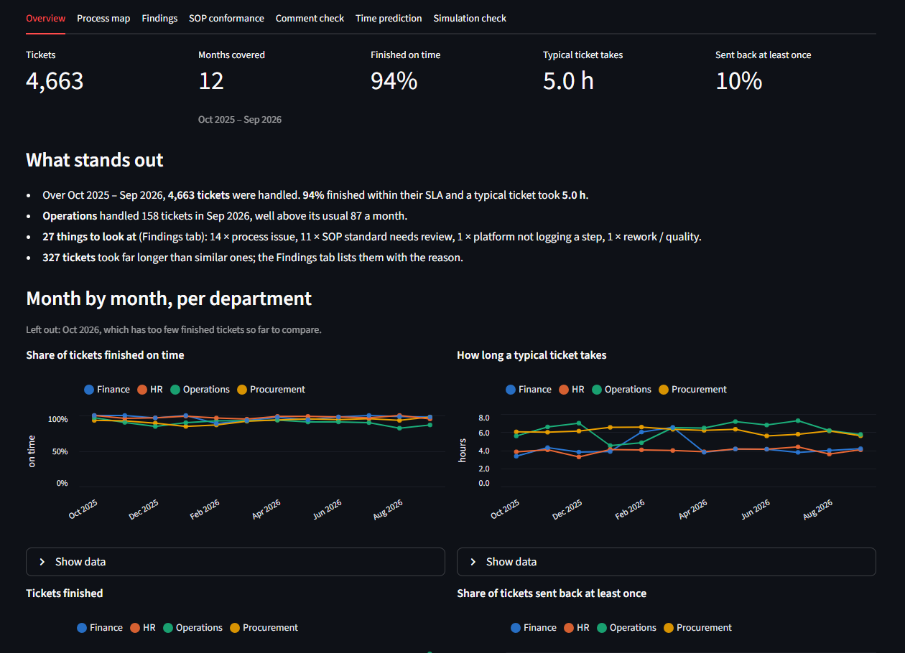
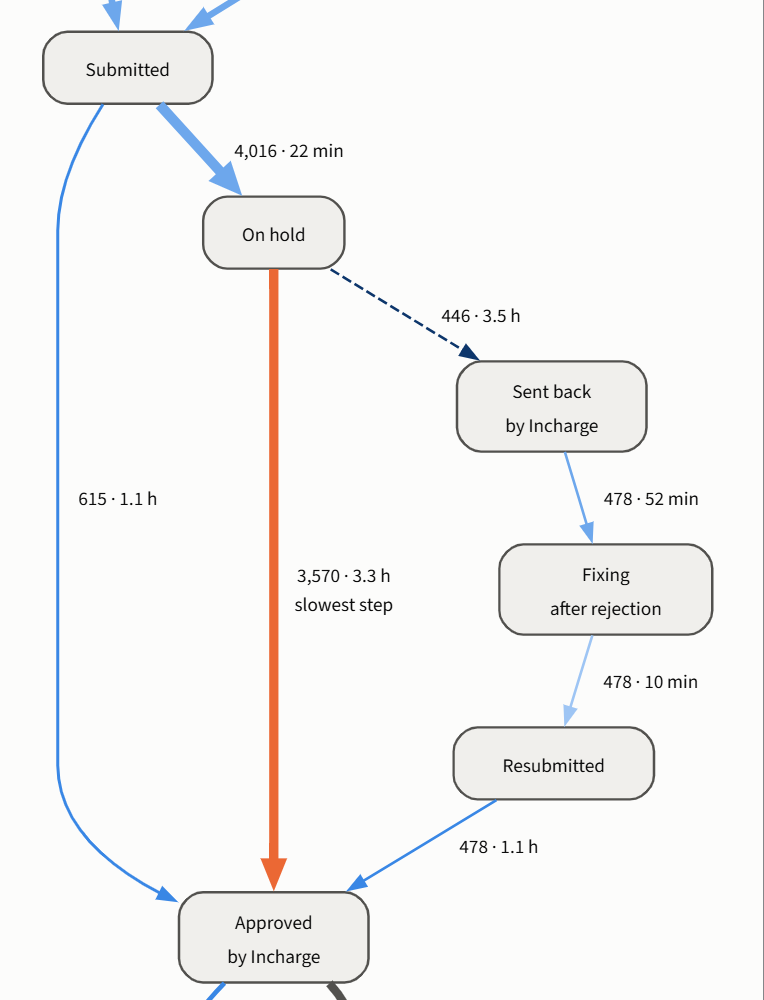
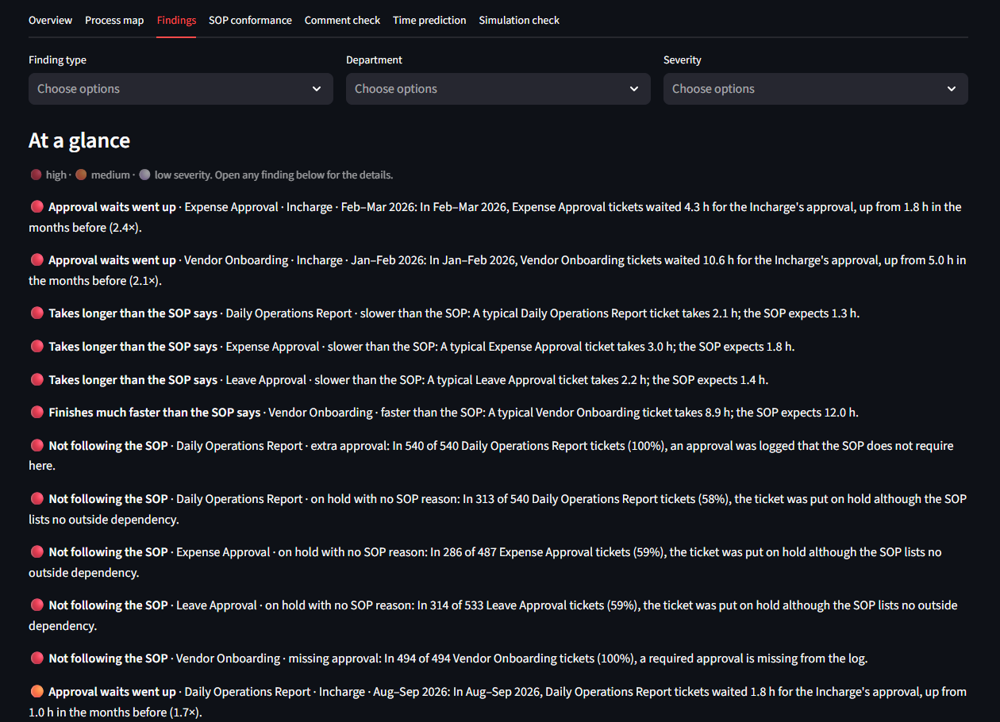
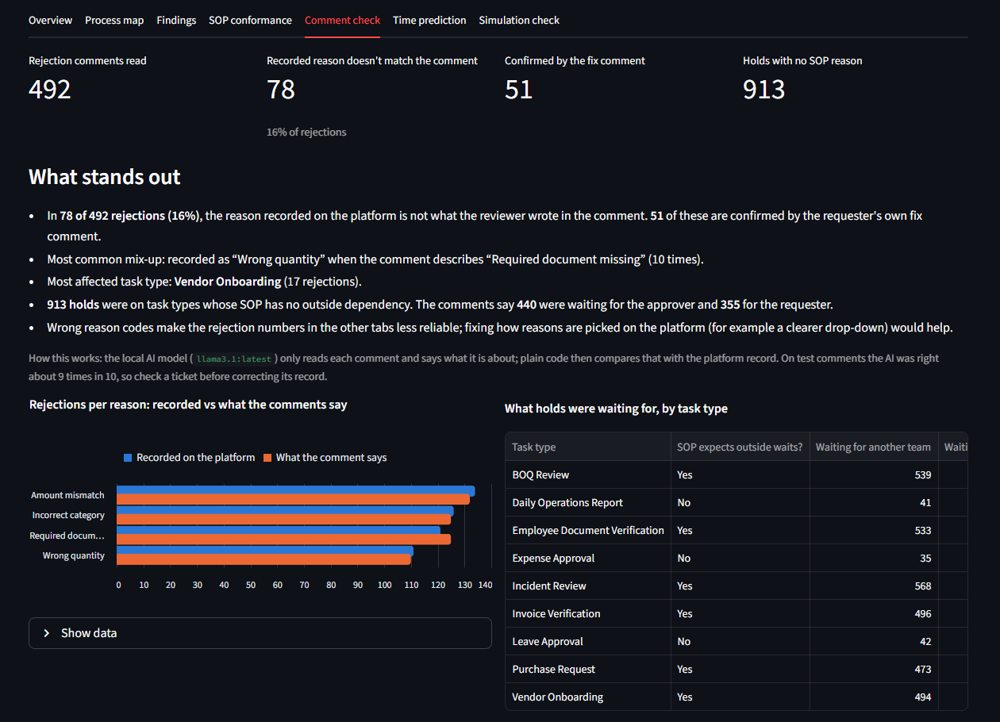
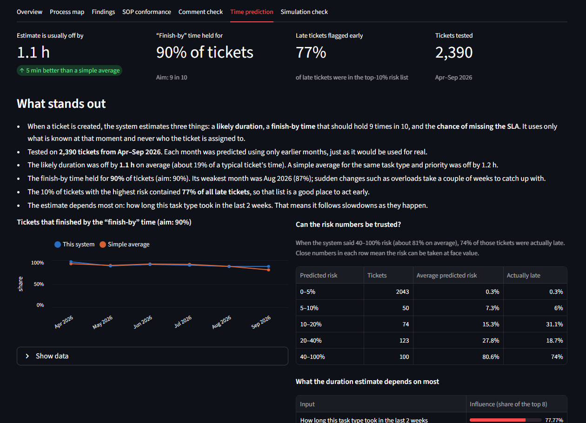

# Process Intelligence: from ticket logs to plain-language findings

**Live dashboard:** [STREAMLIT_URL_PLACEHOLDER](https://process-intelligence-demo.streamlit.app/)

A prototype that reads a ticketing platform's exports (tickets, audit log, comments, SOP documents) and answers:
*where does work get stuck, does it follow the SOP, what do the comments really say, and which new tickets are likely to be late?*
Every result is shown in plain language in a Streamlit dashboard.

> **All data in this repo is synthetic.** It contains no company or personal information. People are fictional IDs.
> By design, the system looks at **processes, not people**: it does not score or rank employees.



---

## What goes in, what comes out

| Input | What we extract |
|---|---|
| `tickets.csv`: one row per task (type, department, priority, SLA, dates) | Duration, SLA met/missed, waiting time vs working time |
| `audit_logs.csv`: every status change, approval, hold, rejection | Each ticket's real path through the process (lifecycle), approval waits, rework loops |
| Comments (free text, often messy: *"qty mismatch pls fix asap"*) | What the comment is actually about, checked against the reason code someone picked from a drop-down |
| SOP documents (21 Markdown files: 9 structured, 12 older free-text) | Expected steps, approvers, dependencies and time standards, which every ticket is checked against |

**Outputs:** findings ("approval waits for Expense Approval went up 2.4× in Feb–Mar 2026"), SOP conformance per ticket, a process map, comment/reason-code mismatches, and a likely-duration plus late-risk prediction for each new ticket.

---

## How we built it, step by step

### Phase 1: deterministic pipeline (no ML)
1. **Validate** the raw exports against a data contract ([docs/data_contract.md](docs/data_contract.md)), quarantining bad rows.
2. **Normalize** platform-specific events into one canonical event schema.
3. **Reconstruct lifecycles:** the ordered steps of each ticket, with working, waiting, on-hold and rework time separated.
4. **Read the SOPs** ([corporate_sops/](corporate_sops/), schema in [SOP_SCHEMA.md](corporate_sops/SOP_SCHEMA.md)) and check how well the logs correspond to them.
5. **Metrics and baselines:** each task type, department and step is compared with its *own* history, never with other teams.
6. **Deviation detection:** robust statistics (median/MAD, sustained over ≥2 months, minimum sample sizes) produce findings, each with a likely cause from **root-cause** rules (workload, approver queue, dependency, rework, and so on).
7. **SOP conformance:** every ticket gets fitness and precision scores, plus checks for skipped approvals, unplanned holds and steps that are not logged.

### Phase 2: harder synthetic data, a local LLM, prediction and a dashboard
8. **Realistic simulator** ([process_intel/sim/](process_intel/sim/)): 4,663 tickets over 12 months, 4 departments, messy comments, and **14 planted scenarios** with an answer key (12 real problems and 2 "must not flag" controls). Five more worlds with different random seeds serve as unseen **holdouts**.
9. **Detection scoring** against the answer key ([run_detection_eval.py](run_detection_eval.py)).
10. **Picking a local LLM:** three 8B models were benchmarked on turning SOP documents into structured data, on both clean and deliberately messy SOP text. **Llama 3.1 8B** (via [Ollama](https://ollama.com)) won on messy text and speed.
11. **SOP drafts plus human review** ([app/sop_review_app.py](app/sop_review_app.py)): the LLM drafts the steps, approvers and dependencies and must quote the SOP sentence for each one; rule-based checks verify every quote, and a person approves or edits.
12. **Comment check** ([process_intel/llm/comment_check.py](process_intel/llm/comment_check.py)): the LLM labels each rejection, correction or hold comment; plain code then compares that label with the reason code that was picked.
13. **Time prediction** ([process_intel/predict.py](process_intel/predict.py)): gradient-boosted quantile models give a likely duration (P50) and a finish-by time (P90), and a classifier gives the risk of missing the SLA. It uses only information available when the ticket is created, and **never who it's assigned to**.
14. **Dashboard** ([app/dashboard.py](app/dashboard.py)): 7 tabs, all translated into plain language by [process_intel/plain.py](process_intel/plain.py).

---

## Results (synthetic data)

### Finding the planted problems

| Data | Real problems found | Controls left alone | False alarms |
|---|---|---|---|
| Main world (`sim_v2`) | **12 / 12** | 2 / 2 | 0 |
| 5 unseen holdout worlds | **58 / 60** | 10 / 10 | 0 |

Both holdout misses are the same scenario, SC05 (a rise in "Incorrect category" rejections).

### LLM choice: SOP document → structured data (9 SOPs, score 0–1)

| Model | Clean SOPs | Messy SOPs | Median seconds per SOP |
|---|---|---|---|
| **llama3.1 8B** (chosen) | 0.978 | **0.947** | **23 s** |
| granite4.1 8B | 0.984 | 0.921 | 33 s |
| ministral-3 8B | 0.998 | 0.877 | 43 s |

The SOP review results: on the 9 structured SOPs, drafts had the right structure on 8, and the one invented approval was caught by the checks. All 12 older free-text SOPs were correctly flagged as too vague to check against.

### Comment check (LLM vs simple keyword rules)

| Test | LLM | Keywords |
|---|---|---|
| Hand-written messy comments, unseen holdout (24) | **92%** | 42% |
| Hand-written messy comments, tuning set (57) | 98% | 58% |
| Simulator's templated comments (4,866) | 92–99% | 100% |

The templated simulator comments are easy for keyword rules. The LLM's value shows on real-style messy text.
**Finding:** 78 of 492 rejections (**16%**) carry a reason code that contradicts the comment (51 of them with high confidence). This matches planted scenario SC13.

### Time prediction (walk-forward: each month predicted using only earlier months, 2,390 tickets)

| | This model | Per-segment average | SOP time standard |
|---|---|---|---|
| Likely duration, typical error | **1.14 h** | 1.22 h | 1.61 h |
| Finish-by (P90) actually held | **89.8%** (target 90%) | 88.3% | 68.2% |
| Late-risk AUC | **0.972** | 0.958 | – |
| Share of late tickets in the riskiest 10% | **77%** | 75% | – |

The duration gain over a simple average is modest on this data. The late-risk list is the useful part.

### Tests
`pytest` runs 109 tests in a fresh clone, covering the pipeline, SOP parsing, conformance, the simulator, the comment check, prediction, the plain-language layer, the process map and the dashboard render.

---

## The dashboard

| Tab | What it shows |
|---|---|
| Overview | Headline numbers, what stands out, monthly trends per department |
| Process map | The real flow of steps from the logs, with the slowest step highlighted |
| Findings | Each finding in plain words: what happened, likely cause, what to check |
| SOP conformance | How closely tickets follow their SOP, and which steps don't fit |
| Comment check | Reason codes that contradict the comment, and why tickets were put on hold |
| Time prediction | Accuracy, risk calibration, and the at-risk ticket list |
| Simulation check | The answer-key scoring (only shown for synthetic data) |

| | |
|---|---|
|  |  |
|  |  |

The hosted dashboard only reads precomputed files in `outputs/`, so it needs no LLM or GPU.

---

## Tech stack
Python 3.12 · pandas, NumPy, SciPy · scikit-learn (HistGradientBoosting quantile regression and classification) · Pydantic (LLM structured output) · Ollama with Llama 3.1 8B (local, temperature 0, cached) · Streamlit + Altair + Graphviz DOT · pytest.

## Run it yourself

```bash
pip install -r requirements.txt

# Dashboards (use the committed outputs; no LLM needed)
streamlit run app/dashboard.py
streamlit run app/sop_review_app.py

# Rebuild everything from the synthetic data
python run_simulator.py                       # -> data/simulated/v2 (seed 2026)
python run_pipeline.py --raw data/simulated/v2/raw --out outputs/sim_v2
python run_detection_eval.py                  # score against the answer key
python run_prediction.py                      # time prediction
python run_comment_check.py                   # needs Ollama + llama3.1 (results are cached)
python run_sop_drafts.py                      # LLM SOP drafts (needs Ollama)
python run_llm_benchmark.py                   # model comparison (needs Ollama)

# Holdout worlds
python run_simulator.py data/simulated/v2_holdout_s7 --seed 7

pytest
```

Phase 1 alone: `python run_pipeline.py` (reads [data/raw/](data/raw/) and writes to [outputs/](outputs/)).

## Repository layout

```
app/              Streamlit dashboard and SOP review screen
process_intel/    pipeline, SOP parsing, conformance, deviations, prediction, process map, plain-language layer
  llm/            Ollama client, SOP extraction/review, comment check
  sim/            synthetic world generator, planted scenarios, evaluation
corporate_sops/   21 synthetic SOP documents + schema
data/raw/         Phase 1 synthetic exports
data/simulated/v2 Phase 2 synthetic world (+ truth/ answer key)
data/benchmark/   hand-labelled messy comments and messy SOP variants
outputs/          precomputed results read by the dashboard
docs/             data contract, assumptions, project context, screenshots
tests/            pytest suite
```

## Limits and next steps
- Everything is validated on synthetic data. The next step is an adapter for the real platform's export format.
- The comment check has been tested on 81 hand-written comments, a small sample, and should be spot-checked on real comments.
- Findings describe processes. The individual-level signals in the data stay behind an off-by-default toggle and are not used for scoring people.
